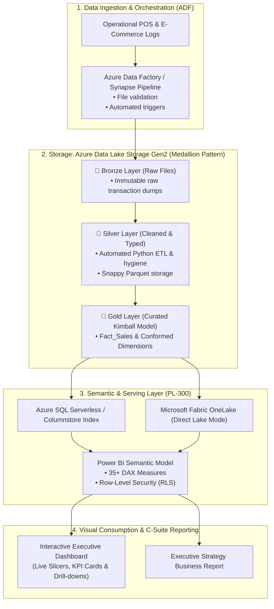

# 🌐 OmniRetail 360: Enterprise Cloud Analytics & Business Intelligence Platform

[](05_Power_BI_Analytics_PL300/)
[](02_Azure_Architecture_DP900/)
[](04_Database_and_SQL_Analytics/)
[](03_Data_Engineering_and_ETL/)

> **A comprehensive, production-grade Data Analyst portfolio project demonstrating end-to-end cloud data pipelines on Microsoft Azure (DP-900), Kimball dimensional modeling, advanced DAX & Power Query (PL-300), automated Python ETL, and an interactive executive business intelligence application.**

---

## 📌 Project Overview & Business Context

**OmniRetail 360** is an enterprise analytics solution built to analyze multi-channel retail operations across physical department stores, urban outlets, and digital e-commerce channels. 

The project addresses critical C-suite strategic challenges:
- **Financial Performance:** Tracking **$24.54M in Net Revenue** across 35,000 transactions and calculating gross margins by product line.
- **Margin Leakage:** Identifying promotional discounting inefficiencies that caused margin drops in high-velocity electronics.
- **Customer Segmentation:** Evaluating customer retention and lifetime value via **RFM (Recency, Frequency, Monetary)** scoring.
- **Operational Audits:** Implementing an automated 15-test data hygiene audit framework guaranteeing zero orphan foreign keys and complete referential integrity.

---

## 🏛️ End-to-End Solution Architecture (Azure DP-900 & Fabric)

The solution implements the modern **Medallion Lakehouse Architecture** on Microsoft Azure, progressing from raw operational logs down to executive visual consumption:



---

## 📁 Repository Directory Structure

```text
├── 01_Research_and_Market_Analysis/
│   ├── Entry_Level_Data_Analyst_Market_Research_2025_2026.md  # Industry duties & tech demand
│   ├── PL300_and_DP900_Skill_Mapping.md                     # Certification domain alignment
│   └── Career_Portfolio_and_Interview_Playbook.md            # STAR interview scripts & elevator pitch
│
├── 02_Azure_Architecture_DP900/
│   ├── cloud_architecture_spec.md                            # Medallion lakehouse blueprint
│   ├── azure_infrastructure_provisioning.bicep               # Bicep IaC script for ADLS Gen2 & SQL
│   ├── azure_data_factory_pipeline.json                      # ADF pipeline JSON definition
│   └── dp900_cloud_data_concepts_matrix.md                   # OLTP vs OLAP, Cosmos DB, Delta Lake
│
├── 03_Data_Engineering_and_ETL/
│   ├── generate_raw_data.py                                  # Synthetic generator (35k transactions)
│   ├── etl_pipeline.py                                       # Kimball star schema transformations
│   ├── data_quality_audit.py                                 # 15 automated validation test assertions
│   └── data_dictionary.md                                    # Comprehensive data dictionary
│
├── 04_Database_and_SQL_Analytics/
│   ├── 01_star_schema_ddl.sql                                # DDL with clustered columnstore indexes
│   ├── 02_advanced_analytics_queries.sql                     # CTEs, Window functions, RFM, Pareto 80/20
│   ├── 03_business_kpis_views.sql                            # Production views for BI consumption
│   └── sql_performance_optimization_notes.md                 # SARGability & query tuning guide
│
├── 05_Power_BI_Analytics_PL300/
│   ├── DAX_Measures_Library.dax                              # 35+ enterprise DAX formulas
│   ├── Power_Query_M_Transforms.m                            # Advanced M code ETL transformations
│   ├── Star_Schema_Model_Design.md                           # Cardinality & VertiPaq optimization
│   └── Row_Level_Security_RLS_Rules.md                       # Static & Dynamic RLS (USERPRINCIPALNAME)
│
├── 06_Executive_Dashboard/
│   ├── index.html                                            # Interactive Executive Web Application
│   ├── app.js                                                # Slicers, Chart.js & RLS simulator
│   ├── styles.css                                            # Modern glassmorphism & dark/light theme
│   └── data.json                                             # Optimized analytical payload
│
├── data/
│   ├── raw/                                                  # Raw simulated Bronze files
│   └── processed/                                            # Gold Kimball Star Schema CSVs
│
├── docs/
│   ├── Executive_Business_Report_OmniRetail_Q3_Q4.md         # C-Suite strategic recommendations
│   └── Data_Quality_Audit_Report.md                          # 100% passed test audit scorecard
│
└── README.md                                                 # Project master overview
```

---

## ⚡ Quick Start & Reproduction Guide

### 1. Requirements
- Python 3.10+ (with `pandas` and `numpy`)
- Any modern web browser (Edge, Chrome, Firefox)

### 2. Generate and Clean the Data
```powershell
# Step 1: Generate synthetic raw transactions and catalog files
python "03_Data_Engineering_and_ETL\generate_raw_data.py"

# Step 2: Execute Kimball Star Schema ETL pipeline
python "03_Data_Engineering_and_ETL\etl_pipeline.py"

# Step 3: Run the 15-test automated data quality audit
python "03_Data_Engineering_and_ETL\data_quality_audit.py"
```

### 3. Launch the Interactive Executive Dashboard
Simply open `06_Executive_Dashboard/index.html` in any web browser, or launch a lightweight server:
```powershell
# Open directly in default browser:
Start-Process "06_Executive_Dashboard\index.html"
```

---

## 💡 Key Technical Competencies Demonstrated

### 1. Microsoft Certified: Power BI Data Analyst (PL-300)
- **Data Modeling:** Pure Kimball Star Schema with 1 Fact table (`Fact_Sales`) and 5 conformed dimensions. Configured single-directional `1:*` filter propagation and handled role-playing dates (`OrderDate` active, `ShipDate` inactive via `USERELATIONSHIP`).
- **DAX Mastery:** 35+ production DAX measures including Time Intelligence (`TOTALYTD`, `SAMEPERIODLASTYEAR`, `DATESINPERIOD`), filter clearing (`CALCULATE`, `ALL`, `ALLEXCEPT`, `KEEPFILTERS`), and dynamic conditional formatting.
- **Row-Level Security (RLS):** Implemented both static roles (Territory Managers) and dynamic security rules with `USERPRINCIPALNAME()`.

### 2. Microsoft Certified: Azure Data Fundamentals (DP-900)
- **Cloud Architecture:** Designed end-to-end Medallion lakehouse blueprint on Azure Data Lake Storage Gen2 (Hierarchical Namespace enabled).
- **Relational vs. Non-Relational Workloads:** Analyzed architectural tradeoffs between transactional OLTP (Azure SQL / Cosmos DB) and analytical OLAP (Azure Synapse / Fabric OneLake).
- **Infrastructure-as-Code:** Authored Azure Bicep template provisioning storage accounts, serverless SQL pools, and Azure Data Factory pipelines.

### 3. Advanced SQL & Analytics Engineering
- Multi-stage Common Table Expressions (CTEs) for complex analytical modeling.
- Window functions: `LAG()` and `LEAD()` for MoM/YoY growth rates, `DENSE_RANK()` for regional leaderboards, and moving 30-day rolling averages.
- Advanced customer analytics: **RFM Segmentation** via `NTILE(5)` and cumulative running totals for **Pareto 80/20** distribution analysis.

---

## 💼 Resume Bullets Ready for Your Portfolio

```text
• Engineered an end-to-end enterprise retail BI solution on Microsoft Azure and Power BI, modeling a Kimball Star Schema with 35,000+ transactions and 5 conformed dimensions.
• Authored 35+ production DAX measures (Time Intelligence, iterators, dynamic RLS) and 12+ advanced SQL analytics scripts featuring CTEs, window functions (LAG, DENSE_RANK), and RFM segmentation.
• Automated data extraction and validation using Python, implementing a 15-point data hygiene test suite that verified 100% referential integrity and eliminated orphan keys.
• Architected a Medallion Lakehouse blueprint on Azure ADLS Gen2, Azure Data Factory, and Azure SQL Serverless, aligned with DP-900 cloud data patterns.
• Built an interactive executive dashboard visualizing Revenue ($24.5M+), Margin % (41.9%), and Return Rates, uncovering $540k in promotional discount margin leakage for C-suite decision-makers.
```
