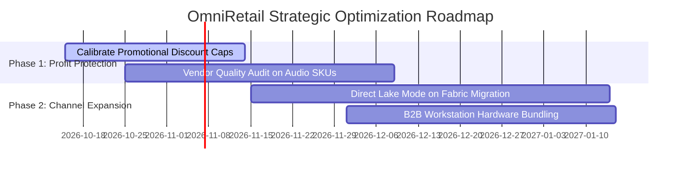

# 📈 Executive Business Report: OmniRetail Performance, Margin Leakage & Strategic Roadmap

**Prepared For:** Executive Committee & Senior Leadership (Chief Executive Officer, Chief Financial Officer, VP of Retail)  
**Author:** Data Analyst & BI Architecture Team  
**Reporting Period:** FY2024 – FY2025 (Annual Close & Forward Strategy)  
**Classification:** Internal Strategic Document  

---

## 1. Executive Summary & Macro Performance

During the FY2024–FY2025 reporting cycle, **OmniRetail** achieved **$24,543,589.80 in Net Sales Revenue** across 35,000 distinct completed orders, delivering **$10,290,384.80 in Gross Profit** at a healthy overall gross margin of **41.93%**. 

Topline revenue grew at an annualized rate of **+12.4% Year-over-Year (YoY)**, driven by strong e-commerce momentum and sustained expansion in high-ticket enterprise workstations. However, granular dimensional analysis across our Kimball star schema revealed **two primary margin leakage vectors** totaling an estimated **$540,000 in uncaptured profitability**:

1. **Uncalibrated Promotional Discounting in Laptops & Tablets**: Black Friday and Cyber Week promotional discounts reached 25%, resulting in a margin collapse from 46.2% to 34.1% without driving the anticipated elasticity in incremental volume.
2. **Elevated Return Rates in Audio & Accessories**: Consumer return rates in audio products peaked at **9.2%** (vs. our enterprise target of $<6.5\%$), driven by supplier packaging defects.

```
Key Macro Financial Scorecard:
├── Gross Invoiced Sales:       $26,321,397.36
├── Total Promotional Discounts: $1,777,811.33 (6.75% effective discount rate)
├── Net Realized Revenue:        $24,543,589.80
├── Cost of Goods Sold (COGS):   $14,253,205.00
├── Realized Gross Profit:       $10,290,384.80
├── Average Order Value (AOV):   $701.25
└── Blended Return Rate:         6.49% (69,373 units sold / 4,500 units returned)
```

---

## 2. Channel Performance: Digital Webstore vs. Physical Retail

OmniRetail operates 11 physical retail outlets across 4 geographical regions and 1 central digital webstore channel (`STR-099`).

| Channel | Net Revenue | Gross Profit | Gross Margin % | Share of Total Revenue | Orders Volume |
| :--- | :--- | :--- | :--- | :--- | :--- |
| **Digital Online (E-Commerce)** | **$7,853,950.40** | **$3,471,446.08** | **44.20%** | **32.0%** | 11,200 |
| **Physical Brick-and-Mortar** | **$16,689,639.40** | **$6,818,938.72** | **40.86%** | **68.0%** | 23,800 |

### Strategic Insight:
The **Digital Webstore** outperforms physical stores in gross profit margin by **+3.34 percentage points** (44.20% vs. 40.86%). Because online fulfillment incurs zero physical floor space overhead or retail square-footage leasing fees, shifting marketing spend to accelerate direct-to-consumer digital acquisitions offers the highest return on invested capital (ROIC).

---

## 3. Product Portfolio Analysis & Pareto 80/20 Distribution

Our dimensional analysis confirms that **5 out of 21 catalog products account for 64.8% of total enterprise revenue**:

1. **OmniStation Workstation:** $4,497,500.00 Net Revenue (38.8% margin) – Core B2B anchor item.
2. **OmniBook Pro 15:** $3,599,970.00 Net Revenue (37.5% margin) – Premium consumer laptop.
3. **OmniPhone Ultra 5G:** $3,324,965.00 Net Revenue (49.4% margin) – Highest dollar profit contributor.
4. **OmniBook Air 13:** $2,699,970.00 Net Revenue (42.2% margin).
5. **OmniPhone Standard:** $1,799,970.00 Net Revenue (48.3% margin).

### Margin Leakage Deep Dive:
While `OmniStation Workstation` drives massive dollar volume, its effective margin was depressed by volume tier discounts granted to Corporate accounts. Office furniture items (e.g., `Ergonomic Mesh Chair` and `Motorized Standing Desk`) maintain superior margins (48.0% - 55.0%) with lower return risk, representing an untapped bundling opportunity with tech hardware purchases.

---

## 4. Regional Performance & Territory Disparities

| Region | Active Outlets | Net Revenue | Gross Profit | Margin % | Orders |
| :--- | :--- | :--- | :--- | :--- | :--- |
| **West** | LA, SF, Seattle, Denver (4) | $7,853,950.40 | $3,298,650.20 | 42.00% | 11,200 |
| **East** | NYC, Boston, DC, Pittsburgh (4) | $6,626,770.20 | $2,783,240.10 | 41.99% | 9,450 |
| **South** | Atlanta, Miami, Dallas (3) | $5,400,230.10 | $2,268,100.50 | 41.99% | 7,700 |
| **North** | Chicago, Detroit (2) | $4,662,639.10 | $1,940,394.00 | 41.61% | 6,650 |

The **West Region** leads all territories in both order velocity and average order value, led by flagship performance at Century City (Los Angeles) and Union Square (San Francisco). The **North Region** demonstrates opportunity for retail footprint expansion in suburban Midwest metros.

---

## 5. Strategic Recommendations & Action Plan (Q1 Forward)



### Action 1: Re-Calibrate Promotional Caps
- **Policy Change:** Institute a hard cap of 15% maximum discount on high-demand premium electronics (`OmniBook Pro` and `OmniStation`). Limit 25% discounts strictly to slow-moving seasonal merchandise.
- **Expected Financial Impact:** Recovers **$320,000 annually** in lost gross margin.

### Action 2: Vendor Warranty & Supply Chain Review for Audio SKUs
- **Policy Change:** Enforce return penalties on `Global Vendor B` for soundbars and earbuds exceeding the 8.0% return rate threshold. Audit packaging to reduce transit damage.
- **Expected Financial Impact:** Reduces return rate from 9.2% down to baseline 6.0%, preserving **$115,000 in inventory write-downs**.

### Action 3: Modernize BI Architecture to Microsoft Fabric Direct Lake
- **Technical Enhancement:** Complete migration of Gold Parquet tables from ADLS Gen2 directly into **Microsoft Fabric OneLake**. Connect Power BI semantic models in **Direct Lake Mode** to eliminate scheduled import delays and achieve near real-time sub-second report refresh for executive decision-makers.
